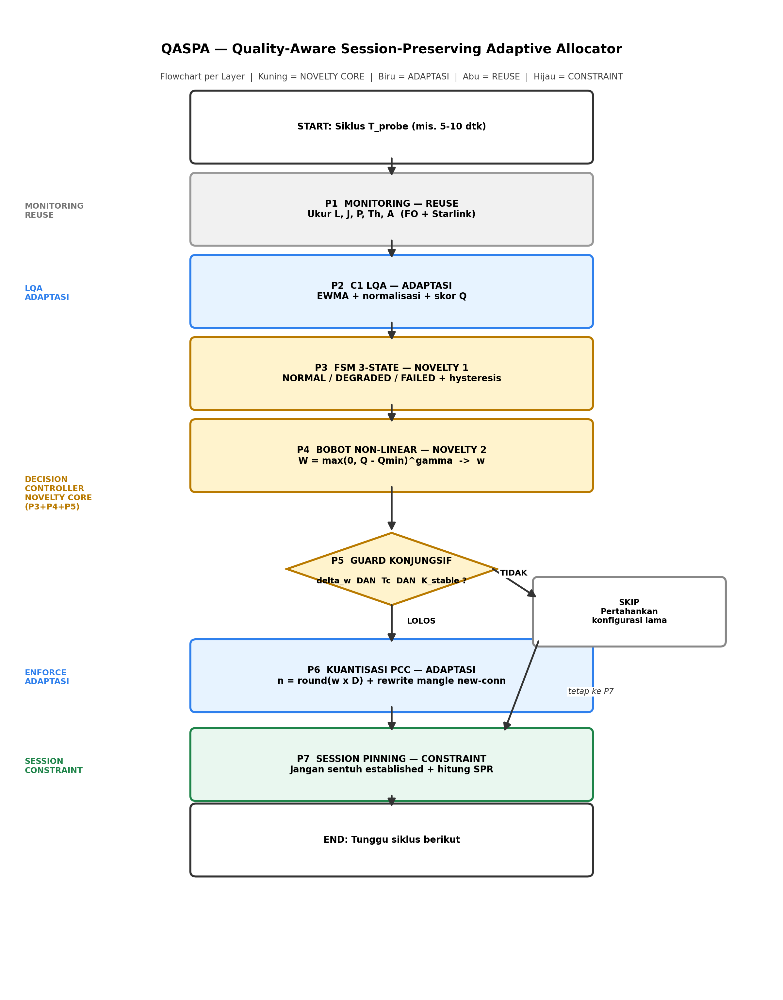
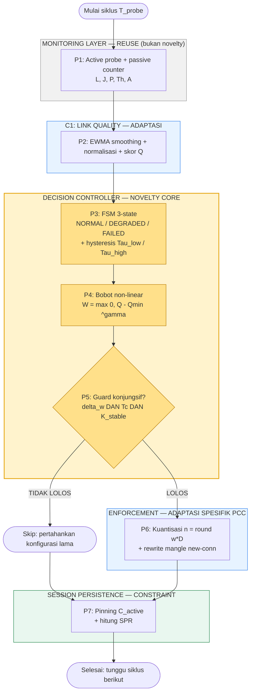

# Pemetaan Algoritma QASPA per Layer + Flowchart dan Letak Novelty

**QASPA — Quality-Aware Session-Preserving Adaptive Allocator**
Pendamping dari `LAPORAN_PEMBAHASAN_QASPA.md`. Dokumen ini memecah QASPA menjadi blok algoritmik dan menandai blok mana yang reuse, adaptasi, dan novelty (gap penelitian).

Notasi sama dengan laporan utama: `L_i, J_i, P_i, Th_i, A_i, Q_i, w_i, n_i, s_i, D, delta_w, Tc, K_stable, SPR`.

---

## 1. Dekomposisi 7 Blok

```
P1. Probe dan koleksi metrik        (Monitoring Layer)
P2. Smoothing + normalisasi + skor  (C1 - LQA)
P3. FSM 3-state + hysteresis       (C2 - Degradation Detection)
P4. Bobot non-linear proporsional   (C3 - Adaptive Allocation)
P5. Guard anti-oscillation konjungsif (C5)
P6. Kuantisasi bucket PCC + enforce (C6 - Adapter MikroTik)
P7. Pinning sesi aktif + SPR        (C4 - Session Persistence)
```

Alur data: `P1 -> P2 -> P3 -> P4 -> P5 -> P6`, dengan `P7` sebagai constraint yang memagari `P6` (apa yang boleh di-rewrite).

---

## 2. Pseudocode QASPA (satu siklus keputusan)

```text
LOOP setiap T_probe:
  # P1 - REUSE
  ukur L_i, J_i, P_i, Th_i, A_i untuk i in {FO, Starlink}

  # P2 - ADAPTASI (kalibrasi LEO) / BARU jika bobot varians-adaptif dipakai
  S_i = alpha*X_i + (1-alpha)*S_i_prev
  qL = 1-min(L/L_max,1); qJ = 1-min(J/J_max,1)
  qP = 1-P/100;          qT = min(Th/Th_ref,1)
  Q_i = wL*qL + wJ*qJ + wP*qP + wT*qT

  # P3 - NOVELTY INTI (aksi beda per state)
  jika A_i==0 selama K_fail            -> s_i = FAILED
  else jika Q_i<Tau_low selama K_deg
       atau drop tiba-tiba >Delta_drop -> s_i = DEGRADED
  else jika s_i==DEGRADED dan Q_i>Tau_high selama K_rec -> s_i = NORMAL
  else jika s_i==FAILED dan pulih            -> s_i = NORMAL/DEGRADED

  # P4 - NOVELTY INTI (supresi non-linear)
  jika s_i==FAILED -> W_i = 0
  else             -> W_i = max(0, Q_i - Q_min)^gamma
  w_i = W_i / sum(W)

  # P5 - NOVELTY INTI (guard konjungsif)
  jika max|w_new - w_old| <= delta_w     -> SKIP (tidak ada update)
  jika t - t_last_update <= Tc           -> SKIP
  jika s_i belum stabil K_stable siklus  -> SKIP

  # P6 - ADAPTASI (jembatan kontinu -> integer PCC)
  n_1 = round(w_1 * D); n_2 = D - n_1
  terapkan n_min kecuali FAILED
  # P7 - CONSTRAINT (hanya new-conn)
  rewrite HANYA rule connection-state=new
  jangan sentuh established, kecuali s_i==FAILED
  t_last_update = t jika ada perubahan
END LOOP
```

---

## 3. Flowchart (Gambar)



Versi Mermaid (cadangan teks):



Cara baca: warna kuning = inti novelty/gap. Biru = adaptasi. Abu-abu = reuse. Hijau = constraint pengaman.

---

## 4. Tabel Layer vs Nilai Novelty

| Layer / Blok | Fungsi | Status | Mengapa di sini gap-nya | Bukti yang wajib ada di tesis |
|---|---|---|---|---|
| Monitoring (P1) | Ping, jitter, loss, counter interface | **REUSE** | Tidak ada yang baru. Semua sistem monitoring bisa. | Akurasi probe, overhead, periode sampling |
| LQA (P2) | EWMA + normalisasi + `Q` komposit | **ADAPTASI**, naik jadi **BARU** jika bobot varians-adaptif | Kalibrasi `L_max/J_max/Th_ref` + `alpha` untuk LEO burst. Bobot statis = lemah. Bobot adaptif varians = novelty. | Sensitivity bobot + ablasi tanpa EWMA |
| FSM 3-state (P3) | Bedakan NORMAL/DEGRADED/FAILED + hysteresis | **NOVELTY INTI 1** | Failover biner hanya kenal up/down. Pembedaan DEGRADED dengan aksi "kurangi new-conn tapi tahan active" adalah kebijakan baru pada konteks PCC. | Detection delay, false positive, flap state |
| Alokasi non-linear (P4) | `W=max(0,Q-Q_min)^gamma` | **NOVELTY INTI 2** | Linear proporsional akan tetap kirim banyak new-conn ke ISP jelek. Supresi non-linear + `Q_min` membuat DEGRADED berat mendekati nol tanpa langsung failover. | `gamma=1` vs `gamma>1`, % new-conn salah jalan |
| Anti-oscillation (P5) | Guard `delta_w + Tc + K_stable` konjungsif | **NOVELTY INTI 3** | Guard tunggal (hanya cooldown) sudah umum. Konjungsi tiga guard + tradeoff curve + bound flap adalah klaim stabilitas yang bisa diuji. | Flap/jam, rewrite count, tradeoff `Tc/delta_w` vs delay |
| Kuantisasi PCC (P6) | `n=round(w*D)` + rewrite `new` saja | **ADAPTASI** | Jembatan wajib kontinu→integer. Tanpa ini core generik tidak bisa jalan di MikroTik. Error kuantisasi harus dilaporkan. | Error `|n/D - w|` untuk `D=10/12/20`, distribusi aktual vs target |
| Session pinning (P7) | Jangan sentuh established + `SPR` | **CONSTRAINT / ADAPTASI** | Menjadikan SPR constraint optimasi, bukan efek samping. Ini yang mencegah "adaptif tapi merusak sesi". | SPR, sesi terputus, recovery time |

---

## 5. Cara Menjawab Penguji: "Novelty-nya di Layer Mana?"

Jawaban satu kalimat:

> Reuse di monitoring, adaptasi di LQA dan kuantisasi PCC, novelty di decision controller yaitu FSM 3-state dengan aksi berbeda + alokasi non-linear + guard anti-oscillation konjungsif yang dievaluasi bersama.

Jika penguji menekan "bukankah itu hanya gabungan?", jawab dengan ablasi:

1. Matikan P5 → flap meledak pada skenario fluktuasi bersamaan.
2. Set `gamma=1` → new-conn bocor ke ISP degradasi.
3. Matikan EWMA → false-positive Starlink naik.
4. Satukan DEGRADED=FAILED → SPR jatuh karena active ikut dipindah.

Setiap ablasi harus menunjukkan penurunan metrik yang berbeda. Itulah bukti bahwa gabungan tersebut bukan tempelan, melainkan setiap lapis menutup satu mode kegagalan.

---

## 6. Implikasi untuk Struktur Tesis / Paper

- Bab karakterisasi: P1 + baseline P2 (bobot tetap). Output: `L_max, J_max, Th_ref, alpha`.
- Bab algoritma: P3 + P4 + P5 sebagai kernel. Sertakan pseudocode di atas verbatim.
- Bab implementasi: P6 + P7 sebagai adapter MikroTik. Sertakan diagram mangle/route dan aturan `connection-state=new` vs `established`.
- Bab evaluasi: skenario normal, degradasi satu sisi, loss tinggi, delay/jitter tinggi, putus total, fluktuasi bersamaan, plus tiga ablasi di Bagian 5.
