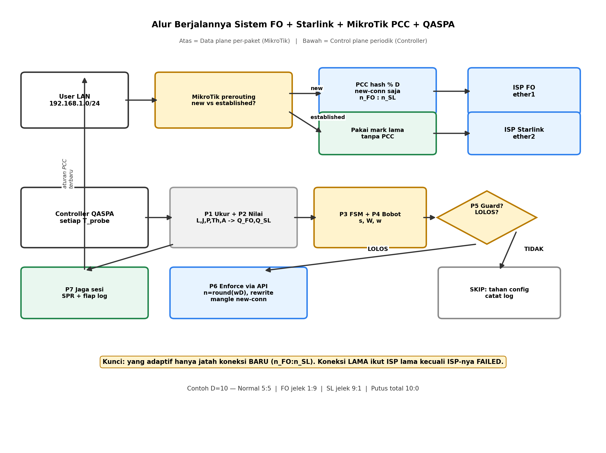
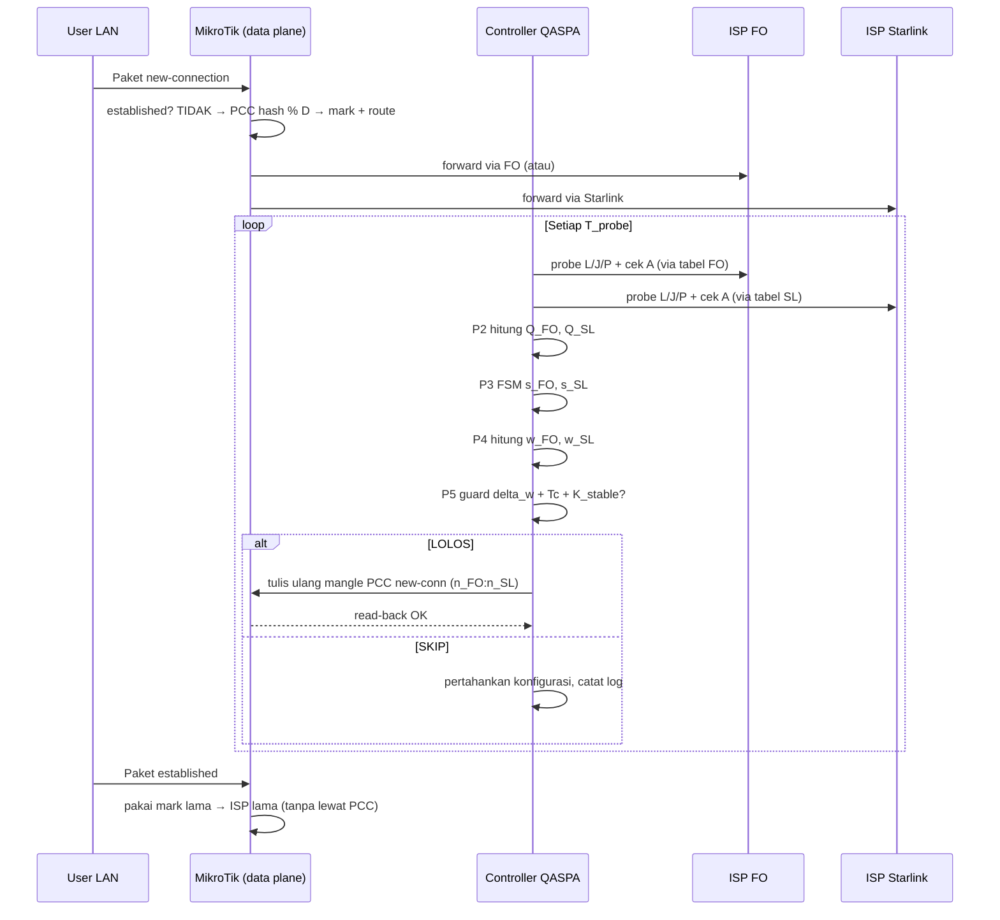

# Alur Berjalannya Sistem: FO + Starlink + MikroTik PCC + Controller QASPA

Dokumen ini menjelaskan **proses runtime end-to-end**: dari paket user masuk sampai keputusan distribusi berubah. Notasi sama dengan `LAPORAN_PEMBAHASAN_QASPA.md` dan `ALGORITMA_QASPA_FLOWCHART.md`.



---

## 1. Gambaran Dua Bidang (Penting untuk Sidang)

Sistem berjalan di dua bidang yang terpisah:

| Bidang | Lokasi | Tugas | Kecepatan |
|---|---|---|---|
| **Data plane** | MikroTik (mangle, routing, NAT) | Meneruskan tiap paket (per-packet, millisecond) | Real-time |
| **Control plane** | Controller eksternal (mini-PC/RPi/VM via RouterOS API) | Mengukur kualitas, menghitung `Q/w/n`, update konfigurasi PCC | Periodik `T_probe` (mis. 5–10 detik) |

Artinya: **tiap paket tidak menunggu controller**. Controller hanya mengubah "aturan main" setiap beberapa detik. Ini yang membuat sistem ringan dan session tetap stabil.

---

## 2. Topologi Acuan

```
[User LAN 192.168.1.0/24]
           |
     [MikroTik RB/x86]
      ether1 -> ISP FO        (gateway FO, routing-table FO)
      ether2 -> ISP Starlink   (gateway Starlink, routing-table SL)
           |
   [Controller QASPA] -- RouterOS API/SSH --> baca counter + tulis mangle/route
           |
     [Time-series DB + log keputusan]
```

Target probe (contoh): gateway FO, gateway Starlink, 1.1.1.1, 8.8.8.8 via masing-masing ISP (policy routing agar probe keluar lewat ISP yang diukur).

---

## 3. Siklus Kontrol Periodik (Control Loop)

Berjalan terus setiap `T_probe`. Satu siklus untuk **kedua ISP bersamaan**:

### Tahap 1 — Ukur (P1, tiap ISP terpisah)

Untuk FO dan Starlink masing-masing:

1. Ping/UDP probe N paket (mis. 10 paket per siklus) lewat routing-table ISP tersebut → dapat `L_i`, `J_i`, `P_i`.
2. Baca interface counter ether1/ether2 (bytes delta / `T_probe`) → estimasi `Th_i` pasif.
3. Cek `A_i`: gateway ping OK + DNS/HTTP OK = 1, selain itu 0.
4. Speedtest aktif **jarang** (mis. tiap 5 menit, bergantian, di luar jam uji puncak) agar tidak mengotori `Th`.

### Tahap 2 — Nilai (P2)

1. Haluskan tiap metrik dengan EWMA (`alpha` 0.2–0.4).
2. Normalisasi ke `qL, qJ, qP, qT` memakai `L_max, J_max, Th_ref` hasil baseline.
3. Hitung skor `Q_FO` dan `Q_SL`.

### Tahap 3 — Klasifikasi (P3, per ISP independen)

```
FO:      Q_FO vs Tau_low/Tau_high + A_FO  -> s_FO
Starlink: Q_SL vs Tau_low/Tau_high + A_SL  -> s_SL
```

Kedua ISP dinilai sendiri-sendiri, tidak dibandingkan langsung. Perbandingan terjadi di tahap bobot.

### Tahap 4 — Alokasi (P4)

```
W_FO = 0 jika s_FO=FAILED, else max(0, Q_FO - Q_min)^gamma
W_SL = 0 jika s_SL=FAILED, else max(0, Q_SL - Q_min)^gamma
w_FO = W_FO/(W_FO+W_SL), w_SL = 1 - w_FO
```

### Tahap 5 — Guard (P5)

Cek tiga syarat konjungsif. Jika satu saja gagal → **tidak ada perubahan konfigurasi**. Siklus selesai, paket tetap mengalir dengan aturan lama.

### Tahap 6 — Enforce ke MikroTik (P6, hanya jika LOLOS)

1. `n_FO = round(w_FO * D)`, `n_SL = D - n_FO` (contoh `D=10`).
2. Terapkan `n_min` kecuali FAILED.
3. Generate ulang rule mangle PCC `new-connection` + connection-mark + routing-mark + route-table.
4. Read-back verifikasi via API, catat `t_last_update`, tulis log: `Q, s, w, n, alasan update`.

### Tahap 7 — Jaga Sesi (P7, selalu)

- Tidak menyentuh rule `established,related`.
- Hitung `SPR`, flap count, detection delay untuk evaluasi.

---

## 4. Alur Paket di MikroTik (Data Plane)

Setiap paket dari LAN melewati urutan ini:

```
1. Prerouting: connection-state == established/related?
     YA -> langsung pakai connection-mark lama -> routing-mark lama -> ISP lama -> NAT -> keluar. SELESAI.
     TIDAK (new) -> lanjut ke 2.
2. Prerouting new-connection: cocokkan PCC classifier sesuai n_FO:n_SL terbaru
     Contoh D=10, n_FO=6, n_SL=4:
       hash % 10 in {0..5} -> mark FO
       hash % 10 in {6..9} -> mark SL
3. Beri connection-mark (FO/SL) + routing-mark (to-FO/to-SL).
4. Routing: pilih gateway sesuai routing-mark (lookup tabel FO atau SL).
5. NAT masquerade per out-interface. Keluar via FO atau Starlink.
6. Paket balasan masuk, connection-tracking mengenali mark lama -> kembali via ISP yang sama.
```

Konsekuensi kunci:

- **Koneksi lama tidak pernah lewat PCC lagi.** Itulah session persistence.
- **Perubahan `n_FO:n_SL` hanya memengaruhi koneksi baru setelah update.** Tidak ada reset massal.
- Pengecualian: jika ISP dinyatakan FAILED, controller boleh menambah rule pengecualian / memindahkan mark tertentu + membiarkan timeout NAT bekerja. Ini satu-satunya kasus active-conn boleh pindah.

---

## 5. Walkthrough Skenario (Contoh Numerik D=10)

Parameter contoh: `Q_min=0.30, gamma=1.8, delta_w=0.10, Tc=45 dtk, Tau_low=0.55, Tau_high=0.65`.

### Skenario A — Keduanya normal

```
Q_FO=0.88, Q_SL=0.82, s_FO=NORMAL, s_SL=NORMAL
W_FO=(0.58)^1.8≈0.37, W_SL=(0.52)^1.8≈0.31
w_FO≈0.54, w_SL≈0.46 -> n_FO=5, n_SL=5
Hasil: new-conn dibagi ~5:5. Established tetap. Tidak ada keluhan.
```

### Skenario B — FO degradasi (loss 6%, jitter naik)

```
Q_FO=0.42 (DEGRADED), Q_SL=0.80 (NORMAL)
W_FO=(0.12)^1.8≈0.02, W_SL=(0.50)^1.8≈0.29
w_FO≈0.07, w_SL≈0.93 -> n_FO=1, n_SL=9 (n_min=1 agar probe FO tetap jalan)
Hasil: hampir semua new-conn ke Starlink. Koneksi FO lama yang masih jalan dipertahankan.
```

### Skenario C — Starlink degradasi (latency spike + jitter burst)

```
Q_FO=0.85, Q_SL=0.48 (DEGRADED)
w_FO≈0.90, w_SL≈0.10 -> n_FO=9, n_SL=1
Hasil: kebalikan skenario B.
```

### Skenario D — Salah satu putus total

```
A_SL=0 selama K_fail -> s_SL=FAILED
w_FO=1, w_SL=0 -> n_FO=10, n_SL=0
Hasil: semua new-conn ke FO. Active-conn Starlink yang kritis boleh di-re-mark/dibiarkan timeout sesuai policy.
```

### Skenario E — Keduanya fluktuasi bersamaan

```
Q_FO dan Q_SL naik-turun 0.55–0.70 tiap siklus.
FSM + hysteresis menahan state agar tidak bolak-balik.
Guard P5 menahan update karena max|w_new - w_old| < delta_w atau Tc belum lewat.
Hasil: konfigurasi stabil, flap/jam rendah. Tanpa P5, mangle akan ditulis ulang tiap siklus.
```

---

## 6. Contoh Aturan MikroTik yang Diubah Controller (Ilustrasi)

Hanya rule `new-connection` yang ditulis ulang. Bentuk logis (bukan sintaks final):

```
# dilewati: established,related -> accept (tidak diubah)

# new-conn FO (sebanyak n_FO classifier):
mangle prerouting: per-connection-classifier=both-addresses:10/0..(n_FO-1), connection-state=new -> mark-connection=via-FO -> mark-routing=to-FO

# new-conn Starlink (sisanya):
mangle prerouting: per-connection-classifier=both-addresses:10/n_FO..9, connection-state=new -> mark-connection=via-SL -> mark-routing=to-SL

# routing:
route table to-FO   -> gateway FO,       check-gateway=ping, distance sesuai
route table to-SL   -> gateway Starlink, check-gateway=ping, distance sesuai
```

Saat `n_FO:n_SL` berubah 5:5 → 9:1, controller menghapus set lama dan menulis set baru secara atomik dalam satu sesi API, lalu verifikasi.

---

## 7. Sequence Diagram (Teks Mermaid)



---

## 8. Cara Menjelaskan ke Penguji dalam 2 Menit

1. Paket baru masuk → PCC bagi sesuai `n_FO:n_SL` terakhir.
2. Paket lama → ikut ISP lama, tidak dibagi ulang.
3. Di latar, controller tiap 5–10 detik mengukur FO dan Starlink sendiri-sendiri.
4. Skor `Q` masuk FSM 3-state, lalu jadi bobot `w`, lalu jadi bucket PCC `n`.
5. Guard menahan update agar tidak flapping saat Starlink spike sesaat.
6. Saat FO jelek: new-conn pindah ke Starlink, yang lama dipertahankan. Saat putus: baru failover total.

Kunci yang membedakan dari PCC biasa: **yang adaptif hanya jatah koneksi baru; koneksi lama dilindungi kecuali ISP-nya mati.**
