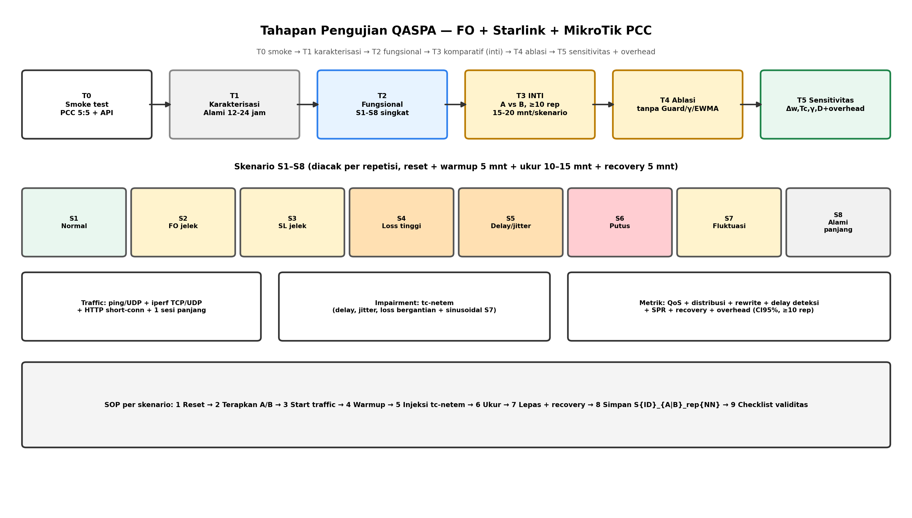

# Tahapan dan Skenario Pengujian QASPA (FO + Starlink + MikroTik PCC)

Dokumen ini adalah prosedur operasional pengujian. Notasi mengikuti `LAPORAN_PEMBAHASAN_QASPA.md` dan `ALGORITMA_QASPA_FLOWCHART.md`. Target: hasil reproducible dan layak klaim Q1/Q2 (repetisi + statistik + ablasi).

---

## 1. Prasyarat dan Baseline

### 1.1 Perangkat dan akses

- MikroTik sebagai data plane (ether1 FO, ether2 Starlink, ether3/LAN user, API aktif).
- Controller QASPA (mini-PC/RPi/VM, satu subnet LAN) dengan akses RouterOS API + SSH fallback.
- Mesin impairment (Linux bridge dengan `tc-netem`) di depan tiap WAN untuk injeksi delay/jitter/loss terkontrol.
- Mesin traffic generator + mesin ukur (bisa satu PC kuat dengan beberapa namespace/VM).
- NTP sinkron di semua perangkat. Tanpa sinkron waktu, detection delay tidak valid.

### 1.2 Kalibrasi baseline (wajib sebelum uji adaptif)

1. Jalankan kedua ISP kondisi normal 3×24 jam (atau minimal 2×12 jam mencakup jam sibuk/senggang).
2. Kumpulkan `L, J, P, Th` mentah per `T_probe` (5–10 dtk).
3. Tetapkan dari data: `L_max` (mis. P95 RTT), `J_max` (P95 jitter), `Th_ref` (median throughput sehat), `alpha` awal 0.3.
4. Tetapkan parameter awal: `Tau_low=0.55, Tau_high=0.65, Q_min=0.30, gamma=1.8, delta_w=0.10, Tc=45 dtk, K_fail=3, K_deg=3, K_rec=5, K_stable=2, D=10, n_min=1`.
5. Catat baseline sebagai pembanding RQ1 (karakteristik FO vs Starlink alami).

Output tahap ini: tabel baseline + file konfigurasi `qaspa.baseline.yaml` yang dipakai di semua skenario.

---

## 2. Tahapan Pengujian (6 Tahap)

### Tahap 0 — Verifikasi fungsi (smoke test)

- Pastikan PCC statis 5:5 meneruskan trafik ke kedua ISP.
- Pastikan controller bisa read counter + write/delete mangle via API + read-back.
- Pastikan probe terikat tabel routing (probe via FO tidak bocor ke Starlink).
- Kriteria lolos: 3/3 cek di atas OK, tidak ada rule `established` yang tertimpa.

### Tahap 1 — Karakterisasi alami (RQ1)

- Tanpa impairment, tanpa adaptif. Hanya ukur FO vs Starlink alami.
- Traffic ringan kontinu (ping + iperf singkat periodik).
- Output: mean/P95 latency, jitter, loss, throughput, pola jam sibuk, frekuensi micro-outage Starlink.
- Kegunaan: justifikasi `alpha`, `Tau`, dan mengapa smoothing + hysteresis wajib.

### Tahap 2 — Uji fungsional adaptif (1 repetisi per kondisi, cepat)

- Aktifkan QASPA lengkap. Jalankan tiap kondisi S1–S8 singkat (5–10 menit) untuk memastikan FSM, bobot, guard, dan enforce berjalan.
- Kriteria lolos: tidak ada crash, tidak ada rewrite tiap detik, SPR tidak anjlok saat normal.

### Tahap 3 — Uji komparatif utama (inti tesis, ≥10 repetisi)

- Bandingkan A (PCC statis) vs B (QASPA lengkap) pada S1–S8.
- Tiap repetisi: reset connection-tracking + reset controller state + acak urutan skenario.
- Durasi per repetisi per skenario: 15–20 menit (5 menit warmup + 10 menit ukur + 5 menit recovery).
- Kumpulkan 11 metrik + log `Q,s,w,n` per siklus.

### Tahap 4 — Ablasi (wajib untuk klaim novelty)

- B1: QASPA tanpa P5 (tanpa guard) → hipotesis flap meledak di S7.
- B2: QASPA dengan `gamma=1` (linear) → hipotesis new-conn bocor ke ISP jelek di S2–S5.
- B3: QASPA tanpa EWMA → hipotesis false-positive naik di Starlink.
- B4: DEGRADED diperlakukan = FAILED → hipotesis SPR jatuh.
- Minimal 5 repetisi per ablasi pada skenario yang relevan (B1 di S7, B2 di S2/S3, B3 di S7, B4 di S2/S3).

### Tahap 5 — Sensitivitas parameter + overhead

- Variasikan satu per satu: `delta_w` {0.05,0.10,0.15}, `Tc` {15,30,60,120 dtk}, `gamma` {1.0,1.5,2.0}, `D` {10,12,20}.
- Ukur tradeoff: detection delay vs flap count vs QoS agregat.
- Ukur overhead: CPU/RAM controller, waktu respons probe→enforce, jumlah API call per jam.
- Output: kurva tradeoff + rekomendasi default, bukan satu titik tuning.

---

## 3. Matriks Skenario (S1–S8)

`tc-netem` dipasang pada bridge impairment masing-masing WAN. Nilai di bawah adalah titik awal, boleh disesuaikan ±20% asal dilaporkan.

| ID | Kondisi | Impairment FO | Impairment Starlink | Durasi ukur | Fokus metrik |
|---|---|---|---|---|---|
| S1 | Normal–normal | tidak ada | tidak ada | 10 mnt | SPR, imbang distribusi, flap≈0 |
| S2 | FO degradasi sedang | delay +80ms, jitter 20ms, loss 2% | tidak ada | 10 mnt | migrasi new-conn ke SL, SPR |
| S3 | Starlink degradasi sedang | tidak ada | delay +80ms, jitter 25ms, loss 2% | 10 mnt | migrasi new-conn ke FO, SPR |
| S4 | Salah satu loss tinggi | bergantian: loss 8% di satu sisi | sisi lain normal | 10 mnt per sisi | loss agregat, % new-conn salah jalan |
| S5 | Salah satu latency/jitter tinggi | delay +150ms, jitter 40ms di satu sisi | sisi lain normal | 10 mnt per sisi | latency/jitter agregat |
| S6 | Salah satu putus total | `A=0` (drop 100% / cabut logis) bergantian | sisi lain normal | 10 mnt per sisi | failover, recovery time, sesi terputus |
| S7 | Fluktuasi bersamaan | pola sinusoidal/acak: delay 20–120ms + loss 0–4% | pola berlawanan fase + burst | 15 mnt | flap count, rewrite count, stabilitas |
| S8 | Baseline alami panjang | tidak ada (alami) | tidak ada (alami) | 12–24 jam | pola harian, P95, micro-outage |

Urutan eksekusi per repetisi diacak (mis. S1,S4a,S2,S6b,…) untuk menghindari bias urutan dan sisa state.

---

## 4. Prosedur Per Skenario (SOP 9 Langkah)

1. Reset: flush connection-tracking uji, reset `t_last_update`, `w_old`, state FSM ke NORMAL.
2. Terapkan konfigurasi pembanding (A PCC statis atau B QASPA) dan verifikasi `n_FO:n_SL` awal.
3. Start traffic generator: iperf3 (TCP+UDP), ping/UDP VoIP-like, HTTP short-conn, 1 streaming panjang untuk SPR.
4. Warmup 5 menit, jangan catat metrik.
5. Terapkan impairment `tc-netem` sesuai matriks (atau tidak ada untuk S1/S8).
6. Ukur 10–15 menit: kumpulkan QoS agregat tiap detik + log controller tiap `T_probe` + hitung distribusi new-conn aktual vs target `w`.
7. Lepas impairment, amati recovery 5 menit (kembali ke NORMAL tanpa flap?).
8. Hentikan traffic, simpan pcap ringkas + log + config snapshot dengan penamaan `S{ID}_{A|B}_rep{NN}_{timestamp}/`.
9. Isi checklist validitas: probe tidak bocor tabel, tidak ada rewrite saat SKIP, tidak ada sentuhan `established` kecuali S6.

---

## 5. Profil Traffic (dipakai di semua skenario)

- `ping + UDP 64B 50pps`: ukur `L, J, P` sensitif.
- `iperf3 TCP 4 stream 60 dtk berulang`: throughput bulk.
- `iperf3 UDP 5 Mbps`: jitter/loss di bawah beban.
- `HTTP short-conn (curl/wrk 10–50 conn/detik)`: uji distribusi new-conn PCC.
- `1 sesi streaming/SSH/VoIP panjang`: uji SPR dan disruption.
- Jangan jalankan speedtest penuh bersamaan dengan ukur latency; jadwalkan terpisah dan beri jeda.

---

## 6. Metrik, Cara Hitung, dan Kriteria

| Metrik | Cara hitung | Sumber | Kriteria sukses QASPA vs PCC |
|---|---|---|---|
| Latency, jitter, loss, throughput agregat | mean + P95 per fase ukur | generator + probe | menang signifikan di S2–S6, imbang di S1 |
| Distribusi new-conn aktual | hitung conn baru per ISP / total | conntrack + log mangle | error vs target `w` < 10% untuk `D=10` |
| Jumlah rewrite PCC | hitung perubahan `n` per jam | log controller | bounded, jauh < varian tanpa guard di S7 |
| Waktu deteksi degradasi | `t_state=DEGRADED/FAILED − t_impairment_on` | log + jam impairment | terukur + tradeoff `Tc/K` dilaporkan |
| Waktu respons controller | `t_enforce − t_deteksi` | log | < 2× `T_probe` + waktu API |
| SPR | sesi wajib-tetap yang tetap / total wajib-tetap | conntrack | >0.95 kecuali S6 |
| Sesi terganggu, recovery time | hitung reset/timeout + `t_pulih − t_lepas` | log + pcap | <50% vs failover agresif, tanpa flap pulih |
| Overhead | CPU/RAM, API call/jam | monitor controller | <10% CPU RPi-class, API < 240 call/jam |

Statistik: tiap sel S×metode minimal 10 repetisi (ablasi 5). Laporkan mean, CI 95%, dan uji beda (t-test/Wilcoxon). Single-run tidak diterima.

---

## 7. Contoh Penamaan dan Format Log

Direktori: `hasil/S2_QASPA_rep03_20261101-193000/`
Isi: `qos.csv, controller.log, mangle_before.txt, mangle_after.txt, tc.conf, params.yaml, notes.txt`.
Baris `controller.log` minimal: `timestamp, Q_FO, Q_SL, s_FO, s_SL, w_FO, w_SL, n_FO, n_SL, aksi(SKIP/UPDATE), alasan`.

---

## 8. Risiko dan Mitigasi Uji

- Starlink alami buruk saat uji S1 → ulangi repetisi, jangan campur alami + injeksi tanpa label.
- Throughput aktif mengotori latency → jadwalkan iperf dan ping pada jendela berbeda, beri jeda 60 dtk.
- Sisa connection-tracking antar repetisi → flush + jeda cooldown 3 menit.
- Controller gagal tulis API → tandai repetisi invalid, jangan dibuang diam-diam; laporkan failure rate API.
