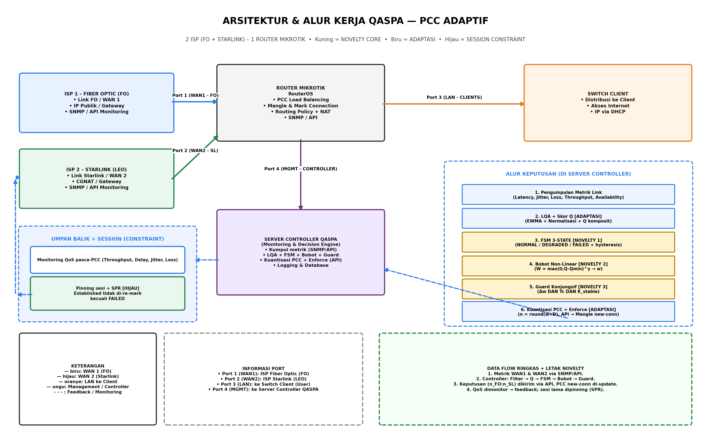
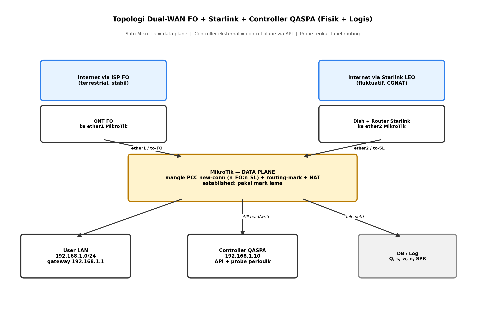

# Konsep Topologi yang Ditawarkan: Dual-WAN FO + Starlink + Controller QASPA



> Gambar di atas adalah versi arsitektur final mengikuti contoh yang Anda berikan, dengan ISP2 diganti VSAT → Starlink (LEO) dan alur keputusan diganti SAW/ALQI → QASPA (LQA + FSM + Bobot + Guard). Kuning = novelty core, biru = adaptasi, hijau = session constraint.



## 1. Ide dasar

Topologi fisik sederhana **dual-homed single-router**: satu MikroTik sebagai satu-satunya forwarding plane dengan dua uplink berbeda karakter (terrestrial stabil + LEO fluktuatif), ditambah satu controller eksternal sebagai control plane. Tidak perlu dua router, tidak perlu BGP, tidak perlu SD-WAN overlay. Kompleksitas dipindah ke controller yang stateless terhadap forwarding.

```
         +-----------+      +------------+
         | ONT FO    |      | Dish Starlink|
         | (ISP-1)   |      | (ISP-2)      |
         +-----+-----+      +------+-------+
               |                   |
          ether1|              ether2|
         +------+-------------------+------+
         |        MikroTik (data plane)    |
         |  mangle PCC + routing-mark+NAT |
         +------+-------------------+-----+
                | LAN bridge / ether3-4
                |
     +----------+----------+--------------------+
     |                     |                    |
 [User LAN]      [Controller QASPA]      [Monitoring/DB opsional]
 192.168.1.0/24   192.168.1.10 via API   log Q,s,w,n,SPR
```

## 2. Pemetaan interface dan pengalamatan (contoh)

| Perangkat | Interface | Alamat / koneksi | Keterangan |
|---|---|---|---|
| MikroTik ether1 | WAN FO | DHCP/static dari ONT, mis. `103.x.x.x` atau `192.168.100.2/30`, gateway `gw-FO` | Tabel routing `to-FO`, `check-gateway=ping` |
| MikroTik ether2 | WAN Starlink | DHCP dari router Starlink, mis. `192.168.10.2/24`, gateway `192.168.10.1` | Tabel routing `to-SL`, CGNAT di sisi Starlink |
| MikroTik ether3+/bridge | LAN | `192.168.1.1/24` | DHCP server + DNS cache untuk user |
| Controller | LAN | `192.168.1.10/24` | Akses RouterOS API (8728/8729 TLS) + SSH fallback |
| Target probe | logis | `gw-FO`, `192.168.10.1`, `1.1.1.1` dan `8.8.8.8` via tiap tabel | Policy routing agar probe keluar via ISP yang diukur |

Controller tidak menjadi gateway. Ia hanya klien API. Jika controller mati, MikroTik tetap jalan dengan konfigurasi PCC terakhir (fail-safe).

## 3. Topologi logis (policy routing)

Fisiknya satu router, logisnya dua jalur terisolasi:

- `connection-mark=via-FO` -> `routing-mark=to-FO` -> `tabel to-FO` -> `gateway gw-FO` -> NAT ether1.
- `connection-mark=via-SL` -> `routing-mark=to-SL` -> `tabel to-SL` -> `gateway 192.168.10.1` -> NAT ether2.
- `connection-state=established,related` -> accept sebelum PCC, jadi tidak pernah diklasifikasi ulang.
- `connection-state=new` -> masuk rantai PCC `both-addresses:D` sesuai `n_FO:n_SL` terbaru dari controller.
- Probe controller memakai `routing-mark` yang sama agar tiap pengukuran terikat ke satu ISP.

## 4. Aliran kontrol vs aliran data pada topologi ini

- Data user: `LAN -> MikroTik prerouting -> NAT -> FO/Starlink -> Internet`. Tidak lewat controller.
- Kontrol: `Controller -> probe via MikroTik ke tiap ISP -> hitung Q/s/w -> tulis mangle/route via API -> MikroTik enforce untuk new-conn`.
- Telemetri: MikroTik counter + log controller -> DB time-series untuk evaluasi `SPR`, flap, detection delay.

## 5. Mengapa topologi ini dipilih

1. Satu titik enforcement (single MikroTik) membuat session tracking konsisten. Dua router akan memecah connection-tracking dan merusak SPR.
2. Controller eksternal membuat algoritma reproducible dan testable, tidak terkunci di scripting RouterOS yang terbatas.
3. Probe terikat tabel routing membuat pengukuran FO dan Starlink independen, tidak tercampur load-balance itu sendiri.
4. Fail-safe jelas: controller boleh gagal tanpa mematikan internet; PCC terakhir tetap berlaku plus `check-gateway` + distance sebagai jaring pengaman L3.
5. Portabel: ganti MikroTik dengan OpenWrt/P4/SDN cukup ganti adapter `setWeights(w1,w2)` tanpa mengubah core QASPA.

## 6. Batasan dan asumsi yang harus dinyatakan di tesis

- Starlink di mode standar berada di belakang NAT/CGNAT router Starlink; tidak ada IP publik langsung di ether2 tanpa bypass mode. Uplink/downlink asimetris.
- Throughput pasif dari counter adalah utilisasi, bukan kapasitas. Kapasitas butuh speedtest aktif yang jarang dan terisolasi.
- Satu MikroTik = single point of failure forwarding. Redundansi router di luar cakupan; fokus penelitian adalah keputusan alokasi, bukan HA router.
- Controller dan MikroTik diasumsikan satu domain LAN tepercaya dengan API TLS + user khusus berhak minimal (prinsip least privilege).
